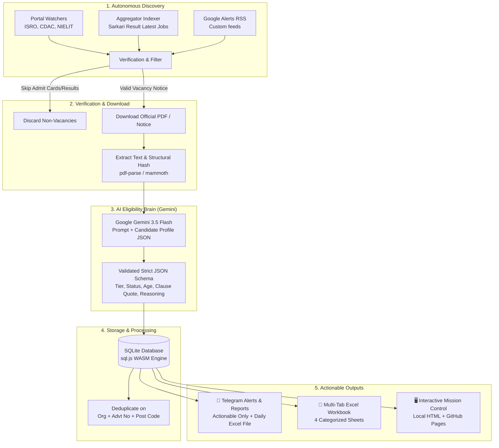

# 🛰️ GovScan AI — Personal Government Job Radar

<div align="center">


<p align="center">
  <strong>An autonomous, local-first intelligence radar that discovers Indian government, PSU, and research vacancies, evaluates candidate eligibility clause-by-clause using Google Gemini, and delivers actionable alerts straight to Telegram, Excel, and an interactive dark-mode dashboard.</strong>
</p>

</div>

---

## 💡 Why GovScan AI?

Searching for Indian government and PSU jobs is notoriously painful:
- Central portals and PSU recruitment pages publish complex 20 to 60 page PDFs.
- Aggregators (like Sarkari Result) post hundreds of ads daily, but 95% do not match your exact degree, age category, or experience.
- Missing an application deadline by a single day means waiting another 1–2 years.

**GovScan AI solves this completely.** It runs quietly in the background on your Windows machine, monitors official career portals and aggregators, downloads real notification documents, passes them to **Google Gemini** for eligibility analysis against your exact educational and demographic profile, and sends you clean, actionable alerts with direct application links.

---

## 🏗️ Architecture & Pipeline Flow



---

## ✨ Key Features

### 1. 🧠 Clause-by-Clause AI Eligibility Checking
* **Zero Guesswork:** Evaluates your qualifications, age, and experience against the actual notification document.
* **4-Tier Job Alignment System:**
  * **🟢 Tier 1 (Exact Core Fit):** Scientist/Engineer 'SC' (Electronics), Project Engineer (Electronics/ECE), Technical Assistant, Scientific Assistant.
  * **🔵 Tier 2 (Technical & Adjacent):** Computer Science / IT / Software / Telecommunications roles, Assistant Professor.
  * **🟡 Tier 3 (General Graduate):** Any-graduate roles (SSC CGL, Banking PO/Clerk, Administrative Officers, MTS).
  * **🔴 Tier 4 (Unrelated Trades):** Civil, Mechanical, Mining, Chemical, Medical, Nursing, Hindi Typist (automatically filtered out).
* **Demographic Awareness:** Evaluates birthdate (`1999-03-23`), category age relaxations (Central **OBC-NCL** $+3$ years), and Bihar domicile reservations.
* **Official Notification Proof:** Automatically cites the **exact page number** and quotes the qualification clause from the PDF.

### 2. 🛡️ Rule 11: Official Document as Source of Truth
* Third-party aggregators (such as Sarkari Result) are used strictly as **discovery hints**.
* The pipeline automatically navigates aggregator tables, retrieves the **official `.gov.in` / PSU notification PDF**, and analyzes the official text — never third-party summaries.

### 3. 📱 Clean, Actionable-Only Telegram Alerts
* **No Spam:** Silences all *"Not Eligible"* and expired posts. You only receive Telegram notifications for jobs where you are **Eligible** or where **Manual Review** is warranted.
* **Rich HTML Format:** Includes Tier badge, organisation, post name, pay scale, age limits, vacancy count, and last date with days-left countdown.
* **One-Click Actions:** Direct clickable buttons for **Official Notification PDF** and **Direct Apply Online Portal**.
* **Daily Document Delivery:** Delivers today's fresh multi-tab `.xlsx` workbook directly to your Telegram chat every morning.

### 4. 🖥️ Interactive Mission Control Dashboard
A standalone, zero-dependency dark-mode dashboard available locally (`data/dashboard.html`) and live on the web via **GitHub Pages**:
* **4-Category Quick Tabs:**
  * 🟢 **Where I Can Apply** *(Eligible + Open Deadline)*
  * 🔍 **Needs Manual Review** *(Equivalence & Borderline checks)*
  * ⏰ **Expired / Closed Deadlines** *(Isolated archive)*
  * 📁 **Full Archive** *(Complete historical record)*
* **📡 Portal Breakdown Bar:** Interactive 1-click filter pills showing real-time distribution across sources (**ISRO Careers**, **Sarkari Result**, **CDAC**, etc.).
* **⏳ Live Countdown Timers:** Real-time urgency chips (`🚨 CLOSING TODAY!`, `🚨 CLOSING TOMORROW!`, `⏰ X days left`).
* **📅 Timeline / Calendar View Switcher:** Toggle between Card Grid and a chronologically organized Timeline view.
* **🎯 Candidate Match Visualizer:** Displays your match chips on every card:
  * 🎓 Degree Match *(e.g. M.Sc Electronics & Comm 78.9% / B.Sc Physics 63.1%)*
  * 🎂 Age Check *(e.g. Age 27 / Max 30 with OBC +3y relaxation)*
  * 💼 Experience Check *(e.g. Freshers Eligible - 0 Yrs Required)*
* **📋 1-Click Copy Details:** Copies a clean, shareable summary to your clipboard with the **Post Name, Organisation, Advertisement / Notification Number, Post Code, Last Date, and Apply URL**.

### 5. 📑 Categorized Multi-Tab Excel Workbook
Generates `data/exports/GovScan_Job_Report_YYYY-MM-DD.xlsx` with custom column widths and 4 dedicated sheets:
1. `1_Ready_To_Apply`
2. `2_Manual_Review`
3. `3_Expired_Deadlines`
4. `4_All_Jobs_Archive`

### 6. ⏰ 100% Autonomous Scheduling
* Automatically scheduled via **Windows Task Scheduler** to execute every morning at **08:30 AM**.
* Handles battery settings, system resumes, logs daily runs to `logs/daily_YYYY-MM-DD.log`, and dispatches emergency Telegram alerts if any unhandled error occurs.

---

## 💰 Zero-Cost Architecture (100% Free)

| Component | Technology | Cost |
| :--- | :--- | :--- |
| **AI Evaluation Brain** | Google Gemini 3.5 Flash (via Google AI Studio) | **₹0** (Free Tier — 1,500 RPD) |
| **Database** | SQLite via `sql.js` (Pure WebAssembly / JS) | **₹0** (Local file storage) |
| **Notification Engine** | Telegram Bot API | **₹0** (Free unlimited messaging) |
| **Online Hosting** | GitHub Pages (`docs/index.html`) | **₹0** (Free static hosting) |
| **Daily Automation** | Windows Task Scheduler (`schtasks`) | **₹0** (Built-in OS scheduler) |
| **Total Monthly Cost** | | **₹0.00** |

---

## 📂 Project Structure

```text
GovScan AI/
├── config/
│   ├── profile.json            # Your degrees, DOB, category, and preferences
│   ├── prompt.txt              # Production Gemini prompt template with few-shot examples
│   ├── settings.json           # Daily API limits, keywords, and Telegram settings
│   └── sources.json            # Active portal watchers & aggregator indexers
├── data/
│   ├── dashboard.html          # Interactive local mission control dashboard
│   ├── exports/                # Multi-tab Excel (.xlsx) & CSV exports
│   └── notices/                # Downloaded official notification PDFs and docs
├── docs/
│   └── index.html              # GitHub Pages deployment bundle for web access
├── logs/                       # Daily execution logs (daily_YYYY-MM-DD.log)
├── scripts/
│   ├── setup-task-scheduler.ps1 # Windows Task Scheduler installer (PowerShell)
│   └── setup-task-scheduler.bat # Windows Task Scheduler installer (Batch)
├── src/
│   ├── cli/
│   │   ├── add.js              # Manually evaluate & insert a PDF or URL
│   │   ├── check.js            # Dry-run test on a notification without saving
│   │   ├── daily-run.js        # Master daily pipeline runner
│   │   ├── dashboard.js        # HTML dashboard generator
│   │   ├── discover.js         # Master discovery runner (watchers + aggregators)
│   │   ├── export-csv.js       # CSV export tool
│   │   ├── export-excel.js     # Multi-tab Excel (.xlsx) export tool
│   │   └── reminders.js        # Deadline countdown alerts & weekly missed reports
│   └── core/
│       ├── config.js           # Configuration loader & validator
│       ├── database.js         # SQLite database schema, upsert, and queries
│       ├── gemini.js           # Gemini API client with fallback & rate limiter
│       ├── pdf-handler.js      # Robust PDF text parser & download manager
│       ├── rss.js              # Google Alerts RSS XML parser
│       ├── sarkari-result.js   # Sarkari Result aggregator hint engine
│       ├── schema.js           # Output validation and auto-salvaging JSON parser
│       ├── telegram.js         # Telegram Bot API client (alerts, reminders, docs)
│       ├── verify.js           # Domain verification & heuristic keyword filter
│       └── watcher.js          # Career page watcher with CSS content hashing
├── .env.example                # Environment variables template
├── DECISIONS.md                # Architectural decision log (D001 – D019)
├── package.json                # Project dependencies and npm scripts
├── README.md                   # Project documentation
└── STATE.md                    # Development milestone and task tracker
```

---

## 🚀 Quick Start Guide

### 1. Prerequisites
* **Node.js:** v20.0.0 or higher (`node -v`)
* **Git:** Installed on Windows (`git --version`)
* **Google Gemini API Key:** Free key from [Google AI Studio](https://aistudio.google.com/)
* **Telegram Bot:** Create a free bot via [@BotFather](https://t.me/BotFather) and get your Chat ID via [@userinfobot](https://t.me/userinfobot)

### 2. Installation
```powershell
# Clone the repository
git clone https://github.com/itsrajaniket/GovScan-AI.git
cd "GovScan AI"

# Install dependencies
npm install
```

### 3. Configuration
Copy `.env.example` to `.env` and fill in your keys:
```env
GEMINI_API_KEY="AIzaSy..."
GEMINI_MODEL="gemini-3.5-flash-lite"
GEMINI_DAILY_LIMIT=1400

TELEGRAM_BOT_TOKEN="1234567890:ABCdef..."
TELEGRAM_CHAT_ID="987654321"
```

Customize your education, DOB, and category in `config/profile.json`:
```json
{
  "name": "Aniket Raj",
  "dob": "1999-03-23",
  "category": "OBC-NCL",
  "domicile": "Bihar",
  "degrees": [
    { "title": "B.Sc (Hons) Physics", "year": 2019, "percentage": 63.13 },
    { "title": "M.Sc Electronics & Communication", "year": 2021, "percentage": 78.88 }
  ]
}
```

---

## 💻 CLI Commands

| Command | Description |
| :--- | :--- |
| `npm run daily` | Executes the complete daily pipeline (reminders, discovery, Gemini checks, alerts, dashboard, and Excel export). |
| `npm run discover` | Runs discovery across all active portals (ISRO, CDAC) and aggregators (Sarkari Result). |
| `npm run dashboard` | Generates and refreshes the interactive dashboard at `data/dashboard.html`. Add `-- --open` to view in browser. |
| `npm run excel` | Generates the categorized 4-tab Excel report at `data/exports/GovScan_Job_Report_YYYY-MM-DD.xlsx`. |
| `npm run check -- <url-or-pdf>` | Tests eligibility on a single notification and outputs validated JSON without saving. |
| `npm run add -- <url-or-pdf>` | Evaluates a single notification and saves the resulting posts into SQLite. |
| `npm run reminders` | Checks upcoming deadlines (7-day / 2-day countdowns) and sends the Sunday missed jobs report. |

---

## 🌐 Enabling Free Web Hosting on GitHub Pages

You can view your dashboard on your phone, tablet, or laptop anytime without running a web server:

1. Go to your repository on GitHub: `https://github.com/<your-username>/GovScan-AI`
2. Click **Settings** (top tabs) &rarr; Select **Pages** (left navigation bar).
3. Under **Build and deployment &rarr; Branch**, select **`main`** and choose folder **`/docs`**.
4. Click **Save**.
5. Within 60 seconds, your personal radar dashboard is live at:
   👉 **`https://<your-username>.github.io/GovScan-AI/`**

---

## 🔒 Privacy & Security

* **Sensitive Data Policy:** GovScan AI **never** requests, collects, or stores government identification numbers (Aadhaar, PAN, Voter ID), application passwords, or financial account credentials.
* **Strict Local-First Storage:** Your SQLite database (`govscan.sqlite`), downloaded PDFs (`data/notices/`), execution logs, and secret `.env` tokens are strictly blocked by `.gitignore` and **never** pushed to GitHub.
* **Non-Invasive Scraping:** All external HTTP requests implement respectful timeouts, rate limits, polite delays, and desktop User-Agent headers.

---

## 📜 License

Created for personal career navigation. Free to use, adapt, and build upon.
Designed with ❤️ for government job aspirants across India.
